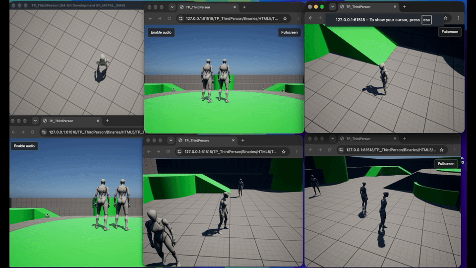

# UnrealEngine-WebGPU

**Build Unreal Engine 5.8.3 games for the browser with WebGPU and WebAssembly.**

[](https://github.com/sponsors/PooyaEimandar)
[](LICENSE)


UnrealEngine-WebGPU adds a WebGPU rendering interface and an HTML5 target
platform to Unreal Engine. The renderer runs natively through Dawn and in
the browser through WebAssembly and WebGPU. The Unreal Editor runs on your
computer; the packaged game runs in the browser.

This public repository contains documentation. The implementation is in the
restricted [Unreal Engine fork](https://github.com/PooyaEimandar/UnrealEngine/tree/5.8-webgpu).
You need access to that fork to follow this guide. This is a modified engine,
not a plugin you can install into the standard Epic Games Launcher build.

[](https://youtu.be/AyVYaKl-kJY)

[▶ Click the preview to watch the full demos on YouTube.](https://youtube.com/playlist?list=PLSttipZ8BrZA&si=N-n6ZkU8vjSJWQRL)

## Why this project

Ten years of building cloud gaming technology, have shown me how much of the gaming community the industry leaves behind: people who cannot afford to buy or continually upgrade gaming hardware, including smartphones.

At the other end of the market, devices such as Meta’s Ray-Ban smart glasses highlight a different constraint. Even people who can afford advanced, premium technology use small devices with limited storage, processing power and battery life. Downloading games that occupy tens of gigabytes and running demanding graphics locally is difficult on such hardware. Streaming has an important role to play here.

Cloud gaming improves accessibility but remains expensive to scale. Even a server with ten GPUs may support only around 64 concurrent players.

I believe hybrid rendering powered by WebGPU offers a better approach by combining local rendering and cloud rendering, allowing games to leverage players’ existing hardware while offloading demanding workloads to the cloud when needed.

The vision is simple: open a link, play instantly, on almost any device without expensive hardware, and at a fraction of traditional cloud gaming costs.

[](https://youtu.be/6WJdi4Iynrc?si=Uy4ehZKxgNOwGEiy)


## Sponsor the project

Getting Unreal Engine into a browser tab is quite the workout. Help it grow
from “look, it runs!” into something developers can confidently ship.

Your support gives me more time for bug fixes, performance improvements,
browser compatibility, Windows/Linux support and better documentation and
perhaps a little more coffee while the shaders compile. ☕

**[Become a GitHub Sponsor 💖](https://github.com/sponsors/PooyaEimandar)**

## Platform status

The current branch is **`5.8-webgpu`**, based on **Unreal Engine 5.8.3**.

| Build host | Status |
|---|---|
| macOS on Apple Silicon | Current development and verified build/package path |
| Windows | Coming soon - build instructions and validation are planned |
| Linux | Coming soon - build instructions and validation are planned |

## Feature support and roadmap

Status describes the current implementation. Planned work has no committed
release date. **Not scheduled** means there is no committed implementation
plan; **Unverified** means compatibility still needs testing.

| Feature | Status | Current behavior | Planned behavior |
|---|---|---|---|
| WebGPU rendering | Supported | Uses Unreal's mobile renderer in the browser and through Dawn natively. Both share rendering limitations. | - |
| Editor packaging | Supported | HTML5 cooking and packaging, Development/Shipping builds and local server launch scripts. | - |
| Packaged hosting | Supported | Bundled Rust host built on Sib serves Wasm, JavaScript and streamed assets. HTTPS prefers HTTP/2 with HTTP/1.1 fallback; localhost asset-only HTTP is also supported. | Validate Windows and Linux host binaries. |
| Core gameplay | Supported | C++/Blueprint gameplay, standard skeletal animation, core Chaos physics and Slate/UMG remain included. | - |
| Standard input | Supported | Keyboard, mouse, touch, standard gamepads, pointer lock and fullscreen. | - |
| Audio playback | Supported | UE audio mixer output through stereo Web Audio. | - |
| HTTP requests | Supported | Standard UE HTTP APIs use browser fetch. | - |
| Persistent saves | Supported | UE save APIs use browser-managed persistent storage. | - |
| Asset streaming | Supported | Cooked pak/IoStore content loads through HTTP ranges, with bounded caching, retries and progress reporting. | - |
| Crash diagnostics | Supported | Browser error reporting, captured logs and development symbol support. | - |
| Multiplayer | Supported | Browser WebTransport datagrams or secure WebSocket connect through a Sib gateway to a native UE UDP server. Replication, RPCs, native/browser co-play and explicit reconnect pass local tests. | Real-user/WAN testing, longer endurance and capacity measurements, account-service integration and broader platform coverage. |
| Video and streaming media | Planned | Browser Media Framework integration, video textures and WebRTC media are unavailable. | Integrate browser video/audio with UE materials and playback controls. HLS remains under evaluation. |
| Advanced content delivery | Planned | No managed downloadable packs, persistent content cache or prefetch policies. | Add downloadable content, versioned caching, prefetch and storage-budget management. |
| WebGPU virtual geometry | Under evaluation | No custom virtual geometry implementation is integrated. | Investigate meshlets, GPU LOD/culling and geometry streaming. Unreal Nanite compatibility and performance parity are not promised. |
| Unreal Nanite | Not scheduled | Unsupported by the current rendering path. | - |
| Desktop rendering features | Not scheduled | Lumen, hardware ray tracing, Path Tracer, Virtual Shadow Maps and TSR are unavailable. | - |
| Additional rendering features | Not scheduled | Virtual textures, mesh distance fields, volumetric clouds, strand-based hair, Compute Framework mesh deformers, sorted-triangle OIT and Substrate specular profiles are disabled or unsupported. | - |
| Advanced input | Not scheduled | IME composition, mobile virtual keyboards, controller vibration and nonstandard gamepad mappings are unavailable. | - |
| Additional audio features | Not scheduled | Microphone capture, voice chat, surround output and output-device selection are unavailable. | - |
| Rendering optimizations | Not scheduled | Parallel RHI execution, browser PSO precaching and GPU timestamp queries are unavailable. | - |
| Browser Launch On | Not scheduled | No browser device appears in the editor's Launch On menu. Packaging and server scripts work. | - |
| Dynamic modules and Live Coding | Not scheduled | The browser executable is monolithic. Dynamic module loading, hot reload and Live Coding are unavailable. | - |
| Larger Wasm memory | Partial | Default memory mode has a 4 GiB heap ceiling. Optional native Memory64 requires additional browser support. | - |
| Native plugins and SDKs | Requires adaptation | Plugins with desktop binaries or OS dependencies cannot be assumed compatible. | No general porting commitment; individual integrations require evaluation. |

## Browser restrictions

These restrictions apply independently of the project's implementation progress:

- **Networking:** ordinary web pages cannot directly use Unreal's native UDP transport. This fork bridges WebTransport or secure WebSocket through a separate gateway. Browser listen servers, raw TCP/UDP sockets and LAN discovery are unavailable.
- **Native integration:** desktop DLLs, external processes and unrestricted filesystem access are unavailable. Integrations must use WebAssembly-compatible code and browser APIs.
- **User interaction:** audio playback may require a click or key press. Fullscreen and pointer lock also follow browser activation and permission policies. See [browser audio policies](https://developer.mozilla.org/en-US/docs/Web/API/Web_Audio_API/Best_practices#autoplay_policy).
- **Storage:** saves and cached assets are subject to browser quotas, eviction and users clearing site data. See [browser storage behavior](https://developer.mozilla.org/en-US/docs/Web/API/File_System_API/Origin_private_file_system).
- **Hosting and capabilities:** this build requires HTTPS or localhost, cross-origin isolation, WebGPU, transferable OffscreenCanvas and WebAssembly JSPI. WebGPU availability alone does not guarantee compatibility.

The default 4 GiB memory ceiling and disabled rendering parallelism are current
implementation constraints, rather than universal browser limits.

## Before you build

| Requirement | What you need |
|---|---|
| Source access | A GitHub account linked to Epic Games, with access to Epic's engine repository and this fork |
| Mac | An Apple Silicon Mac |
| Xcode | Full Xcode with its macOS SDK, selected as the active developer directory. The fork's Apple SDK configuration targets Xcode 26.1.1. Command Line Tools alone are insufficient. |
| Rosetta | Required by the Intel `protoc` executable bundled with UE's build dependencies |
| Build tools | Git, Python 3.9+, CMake 3.22+ and Ninja |
| Rust/Cargo | Stable Rust toolchain to build the bundled native [Sib host](https://github.com/PooyaEimandar/sib) |
| Emscripten | Use **6.0.10**, the version used for project validation; Node.js is supplied by emsdk |
| Browser | Browser with WebGPU, WebAssembly JSPI and transferable OffscreenCanvas |

Local validation used macOS 27.0.1, Emscripten 6.0.10 and Chrome
155.0.8059.81. Safari version 27.0.1 & Firefox Nightly 155.0a1 also rendered the sample. These are recorded results, not minimum
supported browser versions. The generated page checks required capabilities
before downloading the game.

## 1. Get access to the source

1. Follow [Epic's GitHub access guide](https://www.unrealengine.com/ue-on-github)
   to link your Epic Games and GitHub accounts. Accept the GitHub organization
   invitation to finish linking them.
2. While signed in, confirm that you can open
   [EpicGames/UnrealEngine](https://github.com/EpicGames/UnrealEngine).
3. Confirm access to
   [PooyaEimandar/UnrealEngine - `5.8-webgpu`](https://github.com/PooyaEimandar/UnrealEngine/tree/5.8-webgpu).

A GitHub **404** can mean that your account lacks access. If Epic's repository
opens but this fork does not, report the access problem in this public
repository's issues. Access remains subject to Epic's terms; this repository
does not grant an Unreal Engine license.

## 2. Prepare macOS

Install full [Xcode](https://developer.apple.com/xcode/), open it once and
complete its component installation and license prompts. Then select it:

```bash
sudo xcode-select --switch /Applications/Xcode.app/Contents/Developer
sudo xcodebuild -runFirstLaunch
xcodebuild -version
```

Adjust the path if Xcode is installed elsewhere. Install Rosetta if it is
missing, following [Apple's instructions](https://support.apple.com/en-us/102527):

```bash
softwareupdate --install-rosetta
```

Install [Homebrew](https://docs.brew.sh/Installation) and follow its shell
setup instructions, then install the build utilities:

```bash
brew install cmake ninja python
git --version
python3 --version
cmake --version
ninja --version
```

Install stable Rust and Cargo using the
[official rustup instructions](https://rust-lang.org/tools/install/), then open
a new Terminal and verify:

```bash
rustc --version
cargo --version
```

The HTML5 build and packaging steps compile the host automatically. Cargo uses the
repository's lockfile and pinned
[Sib revision `806b59fa59f0`](https://github.com/PooyaEimandar/sib/commit/806b59fa59f060994f663c2faad52dcee00e4845);
a separate Sib checkout is unnecessary. To use a prebuilt host, set
`HTML5_GATEWAY_BINARY` to its absolute path before building or packaging, and
keep its `HTML5Host-Licenses.txt` alongside it.

Install the pinned Emscripten version using the
[official emsdk workflow](https://emscripten.org/docs/getting_started/downloads.html):

```bash
mkdir -p "$HOME/Developer"
git clone https://github.com/emscripten-core/emsdk.git "$HOME/Developer/emsdk"
cd "$HOME/Developer/emsdk"
./emsdk install 6.0.10
./emsdk activate 6.0.10
source ./emsdk_env.sh
emcc --version
node --version
```

Run `source "$HOME/Developer/emsdk/emsdk_env.sh"` in each new Terminal session
used to build or launch the editor. Activating emsdk does not automatically
give Finder-launched applications its environment.

An existing Homebrew Emscripten installation can also be used. Check its version
with `emcc --version`; the current formula may differ from the validated version.
The editor detects standard Homebrew locations automatically, while custom
SDK installations must be available through `EMSDK`, `EMSCRIPTEN` or `PATH`.

## 3. Clone and build the engine

Clone the **engine fork**, separate from this public documentation repository:

```bash
git clone --branch 5.8-webgpu --single-branch \
  https://github.com/PooyaEimandar/UnrealEngine.git \
  "$HOME/Developer/UnrealEngine-WebGPU-Source"
cd "$HOME/Developer/UnrealEngine-WebGPU-Source"
source "$HOME/Developer/emsdk/emsdk_env.sh"
```

Run the following commands from that source directory, in order. Finish each
step successfully before continuing. Keep the editor closed while building.

### Download engine dependencies and check the SDK

```bash
./Setup.sh
Engine/Platforms/HTML5/HTML5Setup.sh
Engine/Build/BatchFiles/RunUBT.sh -Mode=ValidatePlatforms -Platforms=HTML5
```

`Setup.sh` downloads UE's dependencies, including its bundled .NET SDK.
`HTML5Setup.sh` checks prerequisites; it does not install them. SDK validation
must report **HTML5 VALID** before proceeding.

### Build WebGPU dependencies

```bash
python3 Engine/Source/ThirdParty/Dawn/BuildForUE/BuildDawn.py --jobs 6 --test
python3 Engine/Source/ThirdParty/Dawn/BuildForUE/BuildTint.py --jobs 6
Engine/Platforms/HTML5/Build/BuildThirdParty.sh --jobs 6
```

These build native Dawn, the Tint/SPIR-V shader tools and the libraries needed
by the WebAssembly target. The scripts use the repository's pinned dependency
versions. Lower `--jobs` if memory is limited.

### Build the editor, packaging tools and browser runtime

```bash
./GenerateProjectFiles.sh
Engine/Build/BatchFiles/RunUBT.sh UnrealEditor Mac Development -NoUBA
Engine/Build/BatchFiles/RunUBT.sh \
  -Target="ShaderCompileWorker Mac Development" \
  -Target="UnrealPak Mac Development" -NoUBA
Engine/Build/BatchFiles/RunUBT.sh UnrealGame HTML5 Development -NoUBA
```

The first build can take a substantial amount of time. The editor build includes
the HTML5 target modules; `UnrealGame HTML5 Development` produces the shared
browser executable used by the simple Blueprint sample below. C++ projects or
projects with additional runtime plugins may require their own game target.

Do not run another build or cook against this checkout at the same time.
For host-specific failures, including the known Xcode 27 post-build issue,
see the fork's [troubleshooting guide](https://github.com/PooyaEimandar/UnrealEngine/blob/5.8-webgpu/Engine/Platforms/HTML5/docs/TROUBLESHOOTING.md).

## 4. Create your first sample in the editor

Launch the editor you just built from the same Terminal environment:

```bash
cd "$HOME/Developer/UnrealEngine-WebGPU-Source"
source "$HOME/Developer/emsdk/emsdk_env.sh"
Engine/Binaries/Mac/UnrealEditor
```

1. Create a **Games → Third Person** project using **Blueprint** and the
   default variant (**None**). Name it `HTML5ThirdPerson` and save it outside
   the engine source directory, for example under `~/UnrealProjects`.
2. For this basic sample, open **Edit → Plugins** and disable **Gameplay
   StateTree** if enabled. The template enables it, but the shared `UnrealGame`
   executable built above does not include it. Projects that use its features
   need their own target build. Save and restart the editor when prompted.
3. Open `Content/ThirdPerson/Lvl_ThirdPerson` and save the project.
4. In **Project Settings → Maps & Modes**, set **Game Default Map** to
   `Lvl_ThirdPerson`. Set **Editor Startup Map** to the same level if desired.
5. In **Project Settings → Packaging**, use **Development** for the first
   build. Keep **Use Pak File** enabled. In **List of maps to include in a
   packaged build**, add `/Game/ThirdPerson/Lvl_ThirdPerson`.
6. Check **Platforms → SDK Management → HTML5**. The installed SDK should
   show **6.0.10** when using the pinned setup above. A blank AutoSDK entry is
   expected: this platform uses a manually installed SDK.

To reopen this project with the correct engine and SDK environment:

```bash
cd "$HOME/Developer/UnrealEngine-WebGPU-Source"
source "$HOME/Developer/emsdk/emsdk_env.sh"
Engine/Binaries/Mac/UnrealEditor \
  "$HOME/UnrealProjects/HTML5ThirdPerson/HTML5ThirdPerson.uproject"
```

Use your actual project path if you chose a different location. Normal editor
Play runs the native preview; it does not launch the browser build.

## 5. Package the sample from the editor


1. Save all changes.
2. Open **Platforms → Package Project**.
3. Under **Package For**, select **HTML5**. If texture variants are shown,
   choose **DXT** for the first desktop-browser sample.
4. Select **Development** in the packaging menu, or use the project's
   Development setting.
5. Click **Package Project at the top of the submenu**.
6. Choose an output directory outside the project, such as
   `~/UnrealPackages/HTML5ThirdPerson`, and wait for packaging to complete.
   Open the packaging log if an error is reported.

**Package For only selects the target. The top Package Project action starts
the build and opens the output-directory picker.**

The output contains `run.sh`, `run.bat`, the native `html5-gateway` executable,
`HTML5Host-Licenses.txt`, `HTML5Content.txt`, the HTML/JavaScript/Wasm runtime and
cooked content. The host is built for the packaging machine's OS and architecture.

## 6. Run the packaged game in a browser

Locate the folder containing `run.sh` and `html5-gateway`. Keep the complete
directory structure intact. Open a Terminal in that folder and run:

```bash
./run.sh
```

The launcher starts the bundled host at `http://127.0.0.1:8000` and opens the
game in your browser. Use `./run.sh --port 8080` to choose another port, or
`./run.sh --no-open` to serve without opening a browser. Press **Ctrl+C** in
the Terminal to stop the host. Running the package needs neither Python nor Rust.

Asset-only localhost HTTP works without a certificate. Public hosting and the
multiplayer gateway require TLS. The gateway can generate a self-signed
localhost certificate for development; its setup guide explains browser trust.

The included `run.bat` expects a matching Windows host executable. A package
built on Mac includes the Mac host; copying it to another OS does not rebuild
that executable. Windows and Linux host validation is still planned.


## License 

The original documentation in this public repository is copyright
**2026 [PooyaEimandar](https://github.com/PooyaEimandar)** and licensed under
[Creative Commons Attribution 4.0 International](LICENSE). Reuse is permitted
with appropriate attribution, a license link and an indication of changes.

This documentation license does **not** apply to Unreal Engine source code,
engine modifications, commercial plugins, premium add-on code,
Epic-provided assets or third-party components.
Unreal Engine and its modifications remain subject to the
[Unreal Engine EULA](https://www.unrealengine.com/eula/unreal); third-party
components retain their respective licenses.

The banner adapts the [WebGPU logo by W3C](https://www.w3.org/2023/02/webgpu-logos.html),
licensed under [CC BY 4.0](https://creativecommons.org/licenses/by/4.0/).

Unreal Engine is a trademark or registered trademark of [Epic Games, Inc](https://www.epicgames.com/site/home).
This is an independent community project and is not an official Epic Games
product or endorsed by Epic Games.
