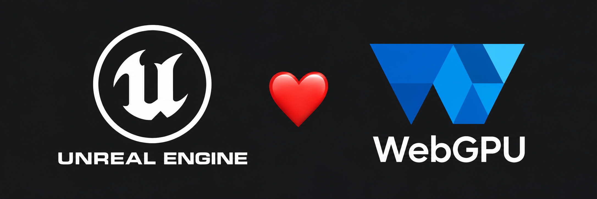
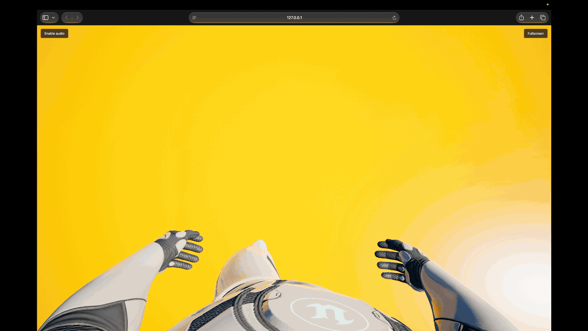
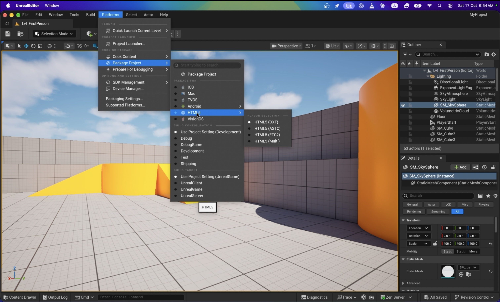
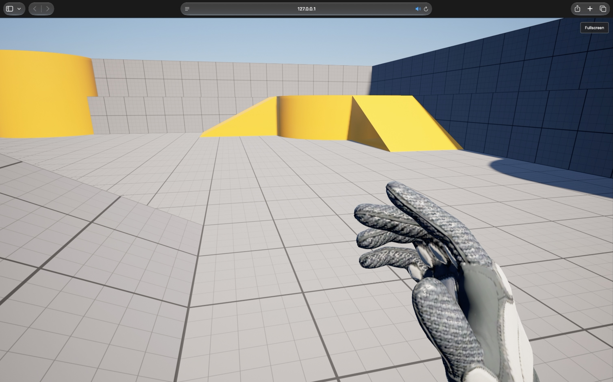

# UnrealEngine-WebGPU

**Build Unreal Engine 5.8.3 games for the browser with WebGPU and WebAssembly.**

[](https://github.com/sponsors/PooyaEimandar)
[](LICENSE)



UnrealEngine-WebGPU adds a WebGPU rendering interface and an HTML5 target
platform to Unreal Engine. The renderer runs natively through Dawn and in
the browser through WebAssembly and WebGPU. The Unreal Editor runs on your
computer; the packaged game runs in the browser.

This public repository contains documentation. The implementation is in the
restricted [Unreal Engine fork](https://github.com/PooyaEimandar/UnrealEngine/tree/5.8-webgpu).
You need access to that fork to follow this guide. This is a modified engine,
not a plugin you can install into the standard Epic Games Launcher build.

[](https://youtu.be/AyVYaKl-kJY)

[▶ Click the preview to watch the full demo on YouTube.](https://youtu.be/AyVYaKl-kJY)

## Sponsor the project

Getting Unreal Engine into a browser tab is quite the workout. Help it grow
from “look, it runs!” into something developers can confidently ship.

Your support gives me more time for bug fixes, performance improvements,
browser compatibility, Windows/Linux support and better documentation—and
perhaps a little more coffee while the shaders compile. ☕

**[Become a GitHub Sponsor 💖](https://github.com/sponsors/PooyaEimandar)**

## Platform status

The current branch is **`5.8-webgpu`**, based on **Unreal Engine 5.8.3**.

| Build host | Status |
|---|---|
| macOS on Apple Silicon | Current development and verified build/package path |
| Windows | Coming soon — build instructions and validation are planned |
| Linux | Coming soon — build instructions and validation are planned |

Windows and Linux builds are not yet validated. Intel Macs and physical
iPhone/iPad/Android devices are also unverified. This project is under active
development; compatibility depends on the browser and GPU.

The browser platform currently includes rendering, input, Web Audio, standard
UE HTTP over fetch, persistent saves, browser services, crash diagnostics and
asset streaming. Multiplayer networking is deferred. The rendering path uses
Unreal's mobile renderer; Nanite and Lumen parity are not provided.

## Before you build

| Requirement | What you need |
|---|---|
| Source access | A GitHub account linked to Epic Games, with access to Epic's engine repository and this fork |
| Mac | An Apple Silicon Mac; the recorded test machine is an M2 Max with 96 GB RAM |
| Xcode | Full Xcode with its macOS SDK, selected as the active developer directory. The fork's Apple SDK configuration targets Xcode 26.1.1. Command Line Tools alone are insufficient. |
| Rosetta | Required by the Intel `protoc` executable bundled with UE's build dependencies |
| Build tools | Git, Python 3.9+, CMake 3.22+ and Ninja |
| Emscripten | Use **6.0.10**, the version used for project validation; Node.js is supplied by emsdk |
| Browser | Chrome with WebGPU, WebAssembly JSPI and transferable OffscreenCanvas; see the tested versions below |

Local validation used macOS 27.0.1, Emscripten 6.0.10 and Chrome
155.0.8059.81. Safari version 27.0.1 & Firefox Nightly 155.0a1 also rendered the sample. These are recorded results, not minimum
supported browser versions. The generated page checks required capabilities
before downloading the game.

## 1. Get access to the source

1. Follow [Epic's GitHub access guide](https://www.unrealengine.com/ue-on-github)
   to link your Epic Games and GitHub accounts. Accept the GitHub organization
   invitation to finish linking them.
2. While signed in, confirm that you can open
   [EpicGames/UnrealEngine](https://github.com/EpicGames/UnrealEngine).
3. Confirm access to
   [PooyaEimandar/UnrealEngine — `5.8-webgpu`](https://github.com/PooyaEimandar/UnrealEngine/tree/5.8-webgpu).

A GitHub **404** can mean that your account lacks access. If Epic's repository
opens but this fork does not, report the access problem in this public
repository's issues. Access remains subject to Epic's terms; this repository
does not grant an Unreal Engine license.

## 2. Prepare macOS

Install full [Xcode](https://developer.apple.com/xcode/), open it once and
complete its component installation and license prompts. Then select it:

```bash
sudo xcode-select --switch /Applications/Xcode.app/Contents/Developer
sudo xcodebuild -runFirstLaunch
xcodebuild -version
```

Adjust the path if Xcode is installed elsewhere. Install Rosetta if it is
missing, following [Apple's instructions](https://support.apple.com/en-us/102527):

```bash
softwareupdate --install-rosetta
```

Install [Homebrew](https://docs.brew.sh/Installation) and follow its shell
setup instructions, then install the build utilities:

```bash
brew install cmake ninja python
git --version
python3 --version
cmake --version
ninja --version
```

Install the pinned Emscripten version using the
[official emsdk workflow](https://emscripten.org/docs/getting_started/downloads.html):

```bash
mkdir -p "$HOME/Developer"
git clone https://github.com/emscripten-core/emsdk.git "$HOME/Developer/emsdk"
cd "$HOME/Developer/emsdk"
./emsdk install 6.0.10
./emsdk activate 6.0.10
source ./emsdk_env.sh
emcc --version
node --version
```

Run `source "$HOME/Developer/emsdk/emsdk_env.sh"` in each new Terminal session
used to build or launch the editor. Activating emsdk does not automatically
give Finder-launched applications its environment.

An existing Homebrew Emscripten installation can also be used. Check its version
with `emcc --version`; the current formula may differ from the validated version.
The editor detects standard Homebrew locations automatically, while custom
SDK installations must be available through `EMSDK`, `EMSCRIPTEN` or `PATH`.

## 3. Clone and build the engine

Clone the **engine fork**, separate from this public documentation repository:

```bash
git clone --branch 5.8-webgpu --single-branch \
  https://github.com/PooyaEimandar/UnrealEngine.git \
  "$HOME/Developer/UnrealEngine-WebGPU-Source"
cd "$HOME/Developer/UnrealEngine-WebGPU-Source"
source "$HOME/Developer/emsdk/emsdk_env.sh"
```

Run the following commands from that source directory, in order. Finish each
step successfully before continuing. Keep the editor closed while building.

### Download engine dependencies and check the SDK

```bash
./Setup.sh
Engine/Platforms/HTML5/HTML5Setup.sh
Engine/Build/BatchFiles/RunUBT.sh -Mode=ValidatePlatforms -Platforms=HTML5
```

`Setup.sh` downloads UE's dependencies, including its bundled .NET SDK.
`HTML5Setup.sh` checks prerequisites; it does not install them. SDK validation
must report **HTML5 VALID** before proceeding.

### Build WebGPU dependencies

```bash
python3 Engine/Source/ThirdParty/Dawn/BuildForUE/BuildDawn.py --jobs 6 --test
python3 Engine/Source/ThirdParty/Dawn/BuildForUE/BuildTint.py --jobs 6
Engine/Platforms/HTML5/Build/BuildThirdParty.sh --jobs 6
```

These build native Dawn, the Tint/SPIR-V shader tools and the libraries needed
by the WebAssembly target. The scripts use the repository's pinned dependency
versions. Lower `--jobs` if memory is limited.

### Build the editor, packaging tools and browser runtime

```bash
./GenerateProjectFiles.sh
Engine/Build/BatchFiles/RunUBT.sh UnrealEditor Mac Development -NoUBA
Engine/Build/BatchFiles/RunUBT.sh \
  -Target="ShaderCompileWorker Mac Development" \
  -Target="UnrealPak Mac Development" -NoUBA
Engine/Build/BatchFiles/RunUBT.sh UnrealGame HTML5 Development -NoUBA
```

The first build can take a substantial amount of time. The editor build includes
the HTML5 target modules; `UnrealGame HTML5 Development` produces the shared
browser executable used by the simple Blueprint sample below. C++ projects or
projects with additional runtime plugins may require their own game target.

Do not run another build or cook against this checkout at the same time.
For host-specific failures, including the known Xcode 27 post-build issue,
see the fork's [troubleshooting guide](https://github.com/PooyaEimandar/UnrealEngine/blob/5.8-webgpu/Engine/Platforms/HTML5/docs/TROUBLESHOOTING.md).

## 4. Create your first sample in the editor

Launch the editor you just built from the same Terminal environment:

```bash
cd "$HOME/Developer/UnrealEngine-WebGPU-Source"
source "$HOME/Developer/emsdk/emsdk_env.sh"
Engine/Binaries/Mac/UnrealEditor
```

1. Create a **Games → Third Person** project using **Blueprint** and the
   default variant (**None**). Name it `HTML5ThirdPerson` and save it outside
   the engine source directory, for example under `~/UnrealProjects`.
2. For this basic sample, open **Edit → Plugins** and disable **Gameplay
   StateTree** if enabled. The template enables it, but the shared `UnrealGame`
   executable built above does not include it. Projects that use its features
   need their own target build. Save and restart the editor when prompted.
3. Open `Content/ThirdPerson/Lvl_ThirdPerson` and save the project.
4. In **Project Settings → Maps & Modes**, set **Game Default Map** to
   `Lvl_ThirdPerson`. Set **Editor Startup Map** to the same level if desired.
5. In **Project Settings → Packaging**, use **Development** for the first
   build. Keep **Use Pak File** enabled. In **List of maps to include in a
   packaged build**, add `/Game/ThirdPerson/Lvl_ThirdPerson`.
6. Check **Platforms → SDK Management → HTML5**. The installed SDK should
   show **6.0.10** when using the pinned setup above. A blank AutoSDK entry is
   expected: this platform uses a manually installed SDK.

To reopen this project with the correct engine and SDK environment:

```bash
cd "$HOME/Developer/UnrealEngine-WebGPU-Source"
source "$HOME/Developer/emsdk/emsdk_env.sh"
Engine/Binaries/Mac/UnrealEditor \
  "$HOME/UnrealProjects/HTML5ThirdPerson/HTML5ThirdPerson.uproject"
```

Use your actual project path if you chose a different location. Normal editor
Play runs the native preview; it does not launch the browser build.

## 5. Package the sample from the editor



1. Save all changes.
2. Open **Platforms → Package Project**.
3. Under **Package For**, select **HTML5**. If texture variants are shown,
   choose **DXT** for the first desktop-browser sample.
4. Select **Development** in the packaging menu, or use the project's
   Development setting.
5. Click **Package Project at the top of the submenu**.
6. Choose an output directory outside the project, such as
   `~/UnrealPackages/HTML5ThirdPerson`, and wait for packaging to complete.
   Open the packaging log if an error is reported.

**Package For only selects the target. The top Package Project action starts
the build and opens the output-directory picker.**

The output contains `serve.py`, `HTML5Content.txt`, the HTML/JavaScript/Wasm
runtime and cooked content. 

## 6. Run the packaged game in a browser

Locate the folder containing `serve.py`. This is the package root used in the next step. Keep the complete directory structure intact. Open a terminal in that folder and run:

```bash
./run.sh # or run.bat
```



## Common problems

| Problem | What to check |
|---|---|
| HTML5 is missing or Package Project is disabled | Use this fork's built editor. Validate the SDK, then save and restart the editor with the SDK environment. Target availability is cached at startup. |
| SDK shows Installed: -- | Source `emsdk_env.sh` and launch the editor from that Terminal. Refresh the SDK report; restart if the editor started without a valid SDK. |
| Clicking Package For does nothing | Select HTML5 there, then click Package Project at the top of the submenu. |
| No browser appears under Quick Launch | Browser Launch On discovery is not implemented. Package the project and use `serve.py`. |
| Packaging requests a missing game target | Check runtime plugins and configuration. Use the sample's plugin setup above, or build the project's own HTML5 target. A Development executable does not satisfy a Shipping package. |
| The page reports missing browser features | Use a browser with WebGPU, JSPI, transferable OffscreenCanvas and cross-origin isolation. WebGPU support alone is insufficient. |
| The first page is blank or the wrong level opens | Check Game Default Map, the packaged map list and the browser diagnostics. Keep the HTML, JavaScript, Wasm and content from the same package. |

## Contribute

Browser/device compatibility reports, reproducible bug reports, documentation
improvements and testing feedback are welcome in this repository's issues.
Include the engine branch or revision, operating system, browser version,
GPU and reproduction steps.

Submit engine implementation changes and discussions containing Engine Code
in the restricted fork. Keep public reports focused on behavior and diagnostics
that can be shared publicly.

## License 

The original documentation in this public repository is copyright
**2026 [PooyaEimandar](https://github.com/PooyaEimandar)** and licensed under
[Creative Commons Attribution 4.0 International](LICENSE). Reuse is permitted
with appropriate attribution, a license link and an indication of changes.

This documentation license does **not** apply to Unreal Engine source code,
engine modifications, commercial plugins, premium add-on code,
Epic-provided assets or third-party components.
Unreal Engine and its modifications remain subject to the
[Unreal Engine EULA](https://www.unrealengine.com/eula/unreal); third-party
components retain their respective licenses.

The banner adapts the [WebGPU logo by W3C](https://www.w3.org/2023/02/webgpu-logos.html),
licensed under [CC BY 4.0](https://creativecommons.org/licenses/by/4.0/).

Unreal Engine is a trademark or registered trademark of Epic Games, Inc.
This is an independent community project and is not an official Epic Games
product or endorsed by Epic Games.
