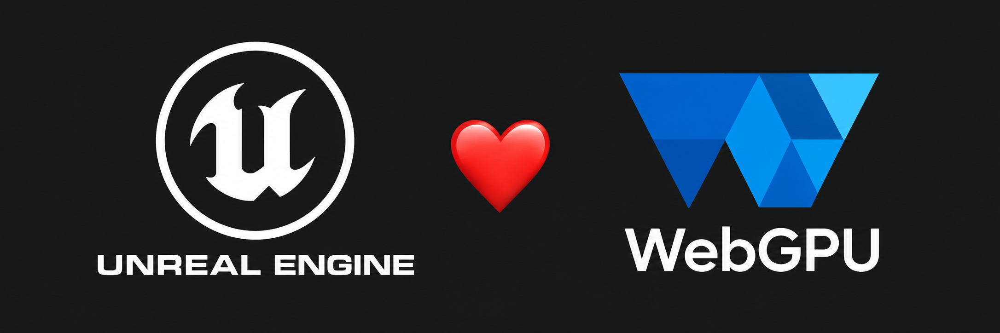
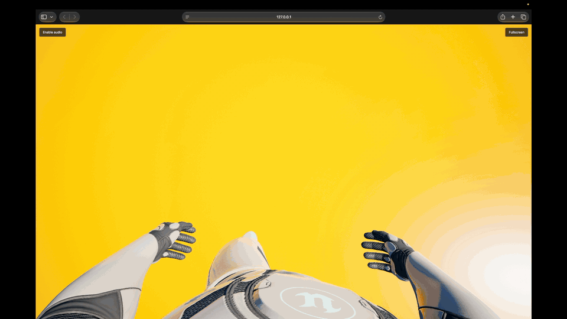
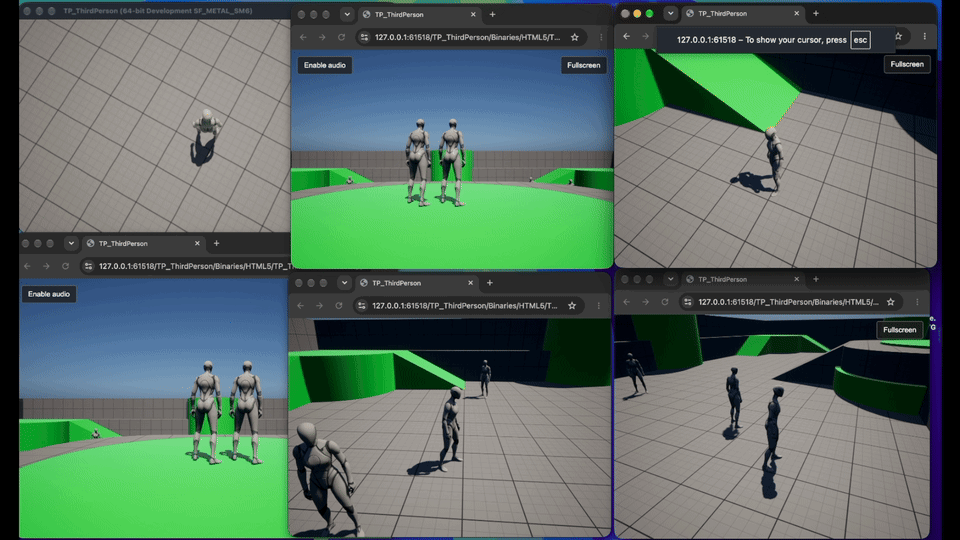

# UnrealEngine-WebGPU

**Build Unreal Engine 5.8.3 games for the browser with WebGPU and WebAssembly.**

UnrealEngine-WebGPU adds a WebGPU rendering interface and an HTML5 target
platform to Unreal Engine. The renderer runs natively through Dawn and in
the browser through WebAssembly and WebGPU. The Unreal Editor runs on your
computer; the packaged game runs in the browser.

This public repository contains documentation. The implementation is in the
restricted [Unreal Engine fork](https://github.com/PooyaEimandar/UnrealEngine/tree/5.8-webgpu).
You need access to that fork to follow the guides. This is a modified engine,
not a plugin you can install into the standard Epic Games Launcher build.

[▶ Click the preview to watch the full demos on YouTube.](https://youtube.com/playlist?list=PLSttipZ8BrZA&si=N-n6ZkU8vjSJWQRL)

## Why this project

The vision is simple: open a link, play instantly, on almost any device
without expensive hardware, and at a fraction of traditional cloud gaming
costs. I believe hybrid rendering powered by WebGPU offers a better approach
by combining local rendering and cloud rendering, allowing games to leverage
players’ existing hardware while offloading demanding workloads to the cloud
when needed. Read the full story in [Why this project](docs/why-this-project.md).

## Sponsor the project

Getting Unreal Engine into a browser tab is quite the workout. Help it grow
from “look, it runs!” into something developers can confidently ship.

Your support gives me more time for bug fixes, performance improvements,
browser compatibility, Windows and Linux GPU validation and better
documentation and perhaps a little more coffee while the shaders compile. ☕

**[Become a GitHub Sponsor 💖](https://github.com/sponsors/PooyaEimandar)**

## Documentation

The current branch is **`5.8-webgpu`**, based on **Unreal Engine 5.8.3**.
macOS on Apple Silicon is the verified development host; Linux x64 and
Windows x64 build and package. The guides live in the `docs` folder.

**Overview**

- [Why this project](docs/why-this-project.md): the motivation and the vision behind the project.
- [Platform status](docs/platform-status.md): supported build hosts, feature support and the roadmap.
- [Browser restrictions](docs/browser-restrictions.md): limits that come from the browser itself.

**Getting started**

Follow these pages in order for a first browser build of the Third Person
template.

1. [Before you build](docs/requirements.md): accounts, tools and the validated environment.
2. [Get access to the source](docs/source-access.md): link your Epic Games and GitHub accounts.
3. Build the engine on your host:
   - [Build on macOS](docs/build-macos.md): the current development host.
   - [Build on Windows](docs/build-windows.md): the Visual Studio toolchain.
   - [Build on Linux](docs/build-linux.md): the pinned Ubuntu 24.04 container and command-line packaging.
4. [Create your first sample in the editor](docs/create-sample-project.md)
5. [Package the sample from the editor](docs/package-project.md)
6. [Run the packaged game in a browser](docs/run-packaged-game.md)

For host-specific build failures, see the fork's
[troubleshooting guide](https://github.com/PooyaEimandar/UnrealEngine/blob/5.8-webgpu/Engine/Platforms/HTML5/docs/TROUBLESHOOTING.md).

## License

The original documentation in this public repository is copyright
**2026 [PooyaEimandar](https://github.com/PooyaEimandar)** and licensed under
[Creative Commons Attribution 4.0 International](LICENSE). Reuse is permitted
with appropriate attribution, a license link and an indication of changes.

This documentation license does **not** apply to Unreal Engine source code,
engine modifications, commercial plugins, premium add-on code,
Epic-provided assets or third-party components.
Unreal Engine and its modifications remain subject to the
[Unreal Engine EULA](https://www.unrealengine.com/eula/unreal); third-party
components retain their respective licenses.

The banner adapts the [WebGPU logo by W3C](https://www.w3.org/2023/02/webgpu-logos.html),
licensed under [CC BY 4.0](https://creativecommons.org/licenses/by/4.0/).

Unreal Engine is a trademark or registered trademark of [Epic Games, Inc](https://www.epicgames.com/site/home).
This is an independent community project and is not an official Epic Games
product or endorsed by Epic Games.
