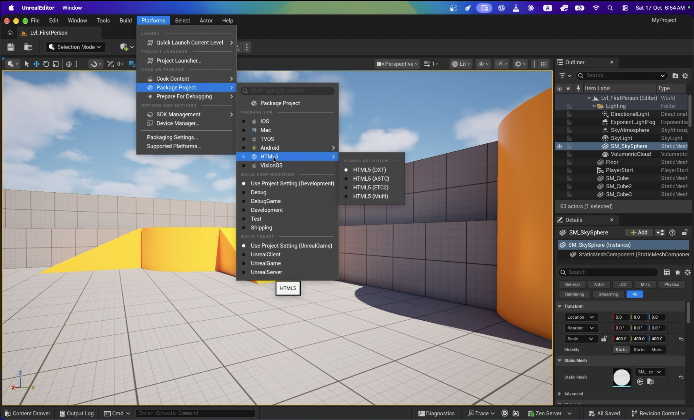

# Package the sample from the editor

1. Save all changes.
2. Open **Platforms → Package Project**.
3. Under **Package For**, select **HTML5**. If texture variants are shown,
   choose **DXT** for the first desktop-browser sample.
4. Select **Development** in the packaging menu, or use the project's
   Development setting.
5. Click **Package Project at the top of the submenu**.
6. Choose an output directory outside the project, such as
   `~/UnrealPackages/HTML5ThirdPerson`, and wait for packaging to complete.
   Open the packaging log if an error is reported.

**Package For only selects the target. The top Package Project action starts
the build and opens the output-directory picker.**

The output contains `run.sh`, `run.bat`, the native `html5-gateway` executable,
`HTML5Host-Licenses.txt`, `HTML5Content.txt`, the HTML/JavaScript/Wasm runtime and
cooked content. The host is built for the packaging machine's OS and architecture.

On Linux, package from the command line instead, as
[Build on Linux](build-linux.md) shows.

---

Next: [Run the packaged game in a browser](run-packaged-game.md)
