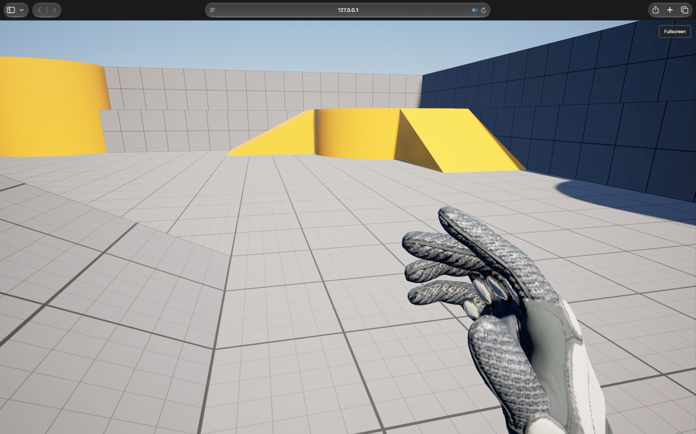

# Run the packaged game in a browser

Locate the folder containing `run.sh` and `html5-gateway`. Keep the complete
directory structure intact. Open a Terminal in that folder and run:

```bash
./run.sh
```

The launcher starts the bundled host at `http://127.0.0.1:8000` and opens the
game in your browser. Use `./run.sh --port 8080` to choose another port, or
`./run.sh --no-open` to serve without opening a browser. Press **Ctrl+C** in
the Terminal to stop the host. Running the package needs neither Python nor Rust.

Asset-only localhost HTTP works without a certificate. Public hosting and the
multiplayer gateway require TLS. The gateway can generate a self-signed
localhost certificate for development; its setup guide explains browser trust.

The host is built for the packaging machine's OS: a Mac package carries the
Mac host, a Linux package the Linux one and a Windows package
`html5-gateway.exe`, which `run.bat` starts. Copying a package to another OS
does not rebuild that executable.



---

Back to the [documentation overview](../README.md#documentation).
