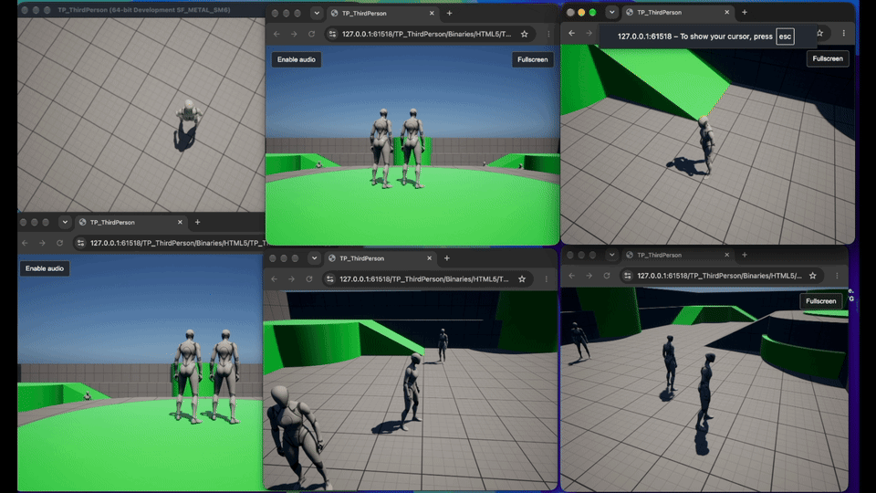

# Why this project

Ten years of building cloud gaming technology, have shown me how much of the gaming community the industry leaves behind: people who cannot afford to buy or continually upgrade gaming hardware, including smartphones.

At the other end of the market, devices such as Meta’s Ray-Ban smart glasses highlight a different constraint. Even people who can afford advanced, premium technology use small devices with limited storage, processing power and battery life. Downloading games that occupy tens of gigabytes and running demanding graphics locally is difficult on such hardware. Streaming has an important role to play here.

Cloud gaming improves accessibility but remains expensive to scale. Even a server with ten GPUs may support only around 64 concurrent players.

I believe hybrid rendering powered by WebGPU offers a better approach by combining local rendering and cloud rendering, allowing games to leverage players’ existing hardware while offloading demanding workloads to the cloud when needed.

The vision is simple: open a link, play instantly, on almost any device without expensive hardware, and at a fraction of traditional cloud gaming costs.

[▶ Watch the full demos on YouTube.](https://youtube.com/playlist?list=PLSttipZ8BrZA&si=N-n6ZkU8vjSJWQRL)
